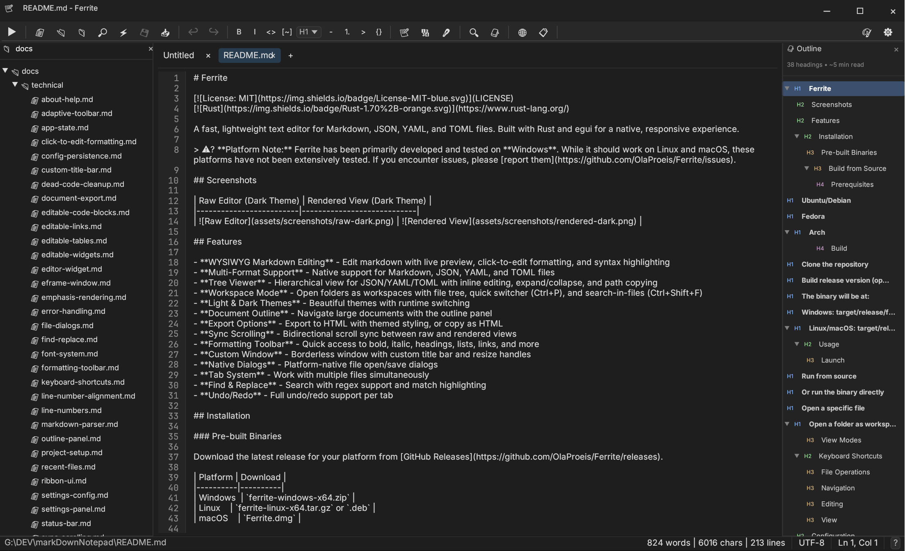

# Ferrite

**English** | [简体中文](README.zh-CN.md)

<div align="center">

[](https://getferrite.dev)
[](https://github.com/OlaProeis/Ferrite/releases)
[](LICENSE)
[](https://github.com/OlaProeis/Ferrite/stargazers)
[](https://github.com/OlaProeis/Ferrite/issues)
[](https://hosted.weblate.org/engage/ferrite/)

**[getferrite.dev](https://getferrite.dev)** — Official website with downloads, features, and documentation

</div>

A fast, lightweight text editor for Markdown, JSON, YAML, and TOML files. Built with Rust and egui for a native, responsive experience.

> ⚠️ **Platform Note:** Ferrite is developed and tested on **Windows** and **Linux**. macOS support is experimental. If you encounter issues, please [report them](https://github.com/OlaProeis/Ferrite/issues).

<details>
<summary><strong>🛡️ Code Signing & Antivirus</strong></summary>

Starting with v0.2.6.1, **all Windows releases are digitally signed** with a certificate from [SignPath Foundation](https://signpath.org). This means:

- **Windows SmartScreen** recognizes the publisher — no more "Unknown publisher" warnings
- **Antivirus false positives** are significantly reduced thanks to the trusted code signature
- **Integrity verification** — you can verify that the binary hasn't been tampered with

### Previous False Positives
Older unsigned builds may still trigger antivirus detections. This was caused by:
- **Live Pipeline feature**: Uses `cmd.exe /C` on Windows for shell commands, which ML-based detection can misidentify
- **Rust compilation patterns**: Rust binaries can trigger heuristic detections due to unique characteristics

We've addressed this through code signing, build profile adjustments (disabled symbol stripping, speed optimization), and reporting to Microsoft's Security Intelligence portal.

### If You're Still Affected
If Windows Defender quarantines Ferrite:
1. **Upgrade**: Download the latest signed release from [GitHub Releases](https://github.com/OlaProeis/Ferrite/releases)
2. **Verify the signature**: Right-click `ferrite.exe` → Properties → Digital Signatures → should show "SignPath Foundation"
3. **Check VirusTotal**: Upload the file to [VirusTotal](https://www.virustotal.com) — signed builds should show clean results

Ferrite does **NOT** access passwords, browser data, or make unsolicited network connections. The only network access is the manual "Check for Updates" button (Settings → About), which contacts the GitHub Releases API when you click it. The application only accesses files you explicitly open.

</details>

<details>
<summary><strong>🍎 macOS Installation & Gatekeeper</strong></summary>

**GitHub Release** `.dmg` / `.tar.gz` builds are packaged as `Ferrite.app` but are **not** signed with an Apple Developer ID and are **not** notarized (CI limitation). **Gatekeeper**, especially on **macOS 15.x (Sequoia / 15.6+)**, may block or warn on first launch—see [GitHub #130](https://github.com/OlaProeis/Ferrite/issues/130) and the workarounds below.

📖 **Full troubleshooting:** [docs/install/macos.md](docs/install/macos.md)

### Option 1: Homebrew (often smoothest)

```bash
brew tap olaproeis/ferrite
brew install --cask ferrite
```

Homebrew typically avoids quarantine friction compared to raw GitHub downloads.

### Option 2: DMG / tar.gz from GitHub Releases + workaround

1. Download from [Releases](https://github.com/OlaProeis/Ferrite/releases):
   - **Apple Silicon:** `ferrite-macos-arm64.dmg` or `.tar.gz`
   - **Intel:** `ferrite-macos-x64.dmg` or `.tar.gz`
2. Copy `Ferrite.app` to **Applications** (or another folder you prefer).
3. **First launch — pick one:**
   - **Terminal (most reliable):** `xattr -dr com.apple.quarantine /Applications/Ferrite.app` — use the real path if the app is not under `/Applications`.
   - **Finder:** Control-click `Ferrite.app` → **Open** → **Open** (may **not** work on every macOS 15.x configuration).
   - **System Settings → Privacy & Security:** after a blocked launch, use **Open Anyway** if shown.

### Why this happens

Apple expects apps distributed outside the Mac App Store to be signed with a **Developer ID** certificate and **notarized**. Ferrite is open source—you can [audit the code](https://github.com/OlaProeis/Ferrite) and [build from source](docs/building.md)—but paid enrollment and CI wiring are still pending for GitHub-hosted macOS builds.

</details>

## 🤖 AI-Assisted Development

This project is 100% AI-generated code. All Rust code, documentation, and configuration was written by Claude (Anthropic) via [Cursor](https://cursor.com) with MCP tools.

<details>
<summary><strong>About the AI workflow</strong></summary>

### My Role
- **Product direction** — Deciding what to build and why
- **Testing** — Running the app, finding bugs, verifying features
- **Review** — Reading generated code, understanding what it does
- **Orchestration** — Managing the AI workflow effectively

### The Workflow
1. **Idea refinement** — Discuss concepts with multiple AIs (Claude, Perplexity, Gemini Pro)
2. **PRD creation** — Generate requirements using [Task Master](https://github.com/task-master-ai/task-master)
3. **Task execution** — Claude Opus handles implementation (preferring larger tasks over many subtasks)
4. **Session handover** — Structured prompts maintain context between sessions
5. **Human review** — Every handover is reviewed; direction adjustments made as needed

📖 **Full details:** [AI Development Workflow](docs/ai-workflow/ai-development-workflow.md)

### Open Process
The actual prompts and documents used to build Ferrite are public:

| Document | Purpose |
|----------|---------|
| [`current-handover-prompt.md`](docs/current-handover-prompt.md) | Active session context |
| [`ai-workflow/`](docs/ai-workflow/) | Full workflow docs, PRDs, historical handovers |
| [`handover/`](docs/handover/) | Reusable handover templates |

This transparency is intentional — I want others to learn from (and improve upon) this approach.

</details>

## Screenshots


| Raw Editor | Split View | Zen Mode |
|------------|------------|----------|
|  |  |  |

> ✨ **v0.3.1 (newest, not yet tagged):** Inline **YouTube video embeds**. **Multi-window**. Mermaid second wave (git graph rewrite, diagram popup, fit-to-pane, `autonumber`, `linkStyle interpolate basis`). **CSV cell editing**. **GitHub HTML subset** and HTML entities. **GFM table alignment**. **Preview lock**. **Search-first Settings** with corruption-safe `config.json`. **Spellcheck**. Separate **Rendered** and **terminal** fonts. **Tab / Shift+Tab indent**. **Emoji** fallback. **Clipboard image paste**. **Reload from Disk**. **CRLF preserved** on edit and save. **Arrow keys** and **Find** in the rendered preview. **macOS Finder Open With**. Typing-run undo. Linux QA close-out (four rounds). Late fixes: encoding save/switch no longer drops or mangles text ([#197](https://github.com/OlaProeis/Ferrite/issues/197), [#198](https://github.com/OlaProeis/Ferrite/issues/198)), CSV cell commits keep mid-file Raw edits ([#196](https://github.com/OlaProeis/Ferrite/issues/196)), rendered list items show nested blocks and keep wrapped lines. LSP stays deferred to v0.3.2+. Linux YouTube Error 153 is deferred to v0.3.2. See [CHANGELOG.md](CHANGELOG.md) § [0.3.1](CHANGELOG.md#031---2026-11-11) and [ROADMAP.md](ROADMAP.md).

> 📦 **v0.3.0:** **eframe / egui 0.34.2** platform refresh. **PDF + themed HTML export**. **Executable code blocks** (`▶ Run`). **Rendered edit session**. **Split-view scroll sync**. **User accent color**. **Mermaid** insert toolbar and flowchart polish. **Phosphor icons**. **Session recovery**. **Quick note workflow**. See [CHANGELOG.md](CHANGELOG.md) § 0.3.0.

> 📦 **v0.2.6 Highlights:** Custom Editor Engine with virtual scrolling (80MB file uses ~80MB RAM), Multi-Cursor Editing, Code Folding, IME/CJK input improvements.

## Features

### Core Editing
- **WYSIWYG Markdown Editing** - Edit markdown with live preview, **one-click block switching** between headings, paragraphs, lists, and table cells in rendered mode, click-to-edit formatting, and syntax highlighting. *(v0.3.1)* Arrow Up/Down moves between rendered blocks (a locked preview scrolls instead); the status bar Ln/Col follows that caret; list items show nested paragraphs, code, quotes, and tables, and a hard-wrapped item keeps its continuation lines
- **Executable Code Blocks** - Run shell or Python fenced blocks from rendered/split preview (`▶ Run`); inline ANSI output, timeout, and Stop (opt-in via Settings; first-run consent)
- **YouTube Video Embeds** *(v0.3.1)* - Use `{{video URL}}` on its own line for inline playback in the rendered preview (primary window); optional `width=640` / `height=360` params set player size (width-only keeps 16:9); bare YouTube links stay normal clickable links; other windows and untrusted hosts show a thumbnail that opens in your browser
- **Multi-Format Support** - Native support for Markdown, JSON, CSV, YAML, and TOML files
- **Multi-Encoding Support** - Auto-detect and preserve file encodings (UTF-8, Latin-1, Shift-JIS, Windows-1252, GBK, and more). *(v0.3.1)* Windows CRLF is kept through edit and save; switching encoding on a dirty file asks first; a legacy encoding that cannot store a character is refused instead of writing `&#NNNN;`
- **Tree Viewer** - Hierarchical view for JSON/YAML/TOML with inline editing, expand/collapse, and path copying
- **Find & Replace** - Search with regex support and match highlighting. *(v0.3.1)* Next/previous scrolls the Rendered and Split preview to the match; literal search is Unicode case-folding (`istanbul` matches `İstanbul`)
- **Go to Line (Ctrl+G)** - Quick navigation to specific line number
- **Undo/Redo** - Full undo/redo support per tab; *(v0.3.1)* a run of typing undoes as one step instead of one keystroke at a time
- **Reload from Disk** *(v0.3.1)* - `Ctrl+Shift+R` replaces the active tab with the file on disk (asks first if the tab has unsaved changes); encoding and line endings are re-detected
- **GitHub HTML Subset** *(v0.3.1)* - `<div align>`, `<details>/<summary>`, `<br>`, `<kbd>`, `<sup>`, `<sub>`, and sized `` render in the preview; HTML entities (`&amp;`, `&rarr;`, `&#…;`) show as characters
- **GFM Table Alignment** *(v0.3.1)* - Per-column left/center/right alignment in rendered tables, with a toolbar control that writes the delimiter row

### View Modes
- **Split View** - Side-by-side raw editor and rendered preview with resizable divider; both panes are fully editable; optional **live scroll sync** (minimap **Sync** / **2-way** controls)
- **Zen Mode** - Distraction-free writing with centered text column
- **Multi-Window** *(v0.3.1)* - `Ctrl+Shift+N` opens a second window with its own tab strip; window layout and per-window tabs are restored on restart
- **Preview Lock** *(v0.3.1)* - Padlock on the preview pane (`Insert`) makes the rendered side read-only while the raw pane stays editable; Up/Down scroll the locked preview

### Editor Features
- **Syntax Highlighting** - Full-file syntax highlighting for 100+ languages (Rust, Python, JavaScript, Go, TypeScript, PowerShell, and more)
- **Code Folding** - Fold/unfold regions with gutter indicators (▶/▼) for headings, code blocks, and lists; collapsed content is hidden
- **Semantic Minimap** - Navigation panel with clickable header labels, content type indicators, and text density bars (switchable to VS Code-style pixel view)
- **Multi-Cursor Editing** - Ctrl+Click to add multiple cursors; type, delete, and navigate at all positions simultaneously
- **Bracket Matching** - Highlight matching brackets `()[]{}<>` and emphasis pairs `**` `__`
- **Auto-close Brackets & Quotes** - Type `(`, `[`, `{`, `"`, or `'` to get matching pair; selection wrapping supported
- **Duplicate Line (Ctrl+Shift+D)** - Duplicate current line or selection
- **Move Line Up/Down (Alt+↑/↓)** - Rearrange lines without cut/paste
- **Smart Paste for Links** - Select text then paste URL to create `[text](url)` markdown link
- **Drag & Drop Images** - Drop images into editor to auto-save to `./assets/` and insert markdown link
- **Paste Images from the Clipboard** *(v0.3.1)* - `Ctrl+V` with an image on the clipboard saves a PNG under `./assets/` and inserts the markdown link. An untitled note with no workspace opens Save As first; nothing is written if you cancel
- **Tab / Shift+Tab Indent** *(v0.3.1)* - Indent or outdent the selected lines in the raw editor (multi-cursor aware; spaces or tabs per settings)
- **Word Wrap Toggle** *(v0.3.1)* - `Alt+Z` flips word wrap from anywhere
- **Emoji Fallback** *(v0.3.1)* - Unicode emoji render (monochrome) in Raw and Rendered instead of missing-glyph boxes
- **Table of Contents** - Generate/update TOC from headings with `<!-- TOC -->` block (Ctrl+Shift+U)
- **Snippets** - Text expansions like `;date` → current date, `;time` → current time, plus custom snippets
- **Auto-Save** - Configurable auto-save with temp-file safety
- **Line Numbers** - Optional line number gutter
- **Configurable Line Width** - Limit text width for readability (80/100/120 or custom)
- **Custom Font Selection** - Choose preferred fonts for editor and UI; important for CJK regional glyph preferences; *(v0.3.1)* the Rendered view can use a different font from the raw editor
- **Keyboard Shortcut Customization** - Rebind shortcuts via settings panel
- **Spellcheck** *(v0.3.1, off by default)* - Hunspell English in the raw editor: dotted underlines, right-click suggestions, personal dictionary, and session ignore. Rendered/Split preview is not checked.
- **Linux middle-click paste** *(v0.3.1)* - On Linux, a selection in the raw editor is the primary selection; middle-click pastes it. The setting is under Editor and does nothing on Windows or macOS

### MermaidJS Diagrams
Native rendering of 11 diagram types directly in the preview:
- Flowchart, Sequence, Pie, State, Mindmap
- Class, ER, Git Graph, Gantt, Timeline, User Journey
- **Insert templates** - Format toolbar → **Insert → Mermaid…** for starter snippets per diagram type
- **Inline validation** - Parse errors in preview with squiggles on broken `mermaid` blocks in the raw editor
- **Flowchart polish** - Improved edge routing, extra shapes, `style` / classDef support; state diagrams support fork/join and history nodes
- **Diagram popup viewer** *(v0.3.1)* - Click a rendered diagram to open a large zoom/pan viewer; wide diagrams shrink to fit the preview with a per-diagram Fit/Native toggle
- **Git graph rewrite** *(v0.3.1)* - Tags, branch types, cherry-pick, and LR/TB orientation; sequence diagrams support `autonumber`; flowcharts support `linkStyle … interpolate basis` and `%% @pos` layout hints

> **v0.3.1 Mermaid update:** Popup zoom/pan viewer, fit-to-pane with a per-diagram Fit/Native toggle, git graph rewrite, `sequenceDiagram` `autonumber`, and flowchart `linkStyle … interpolate basis` (straight diagonals draw as S-curves; a straight chain stays straight) plus `%% @pos` hints. The v0.3.0 insert toolbar, F1 syntax help, inline validation, and edge routing are unchanged. Dense diagrams and subgraph layout can still differ from mermaid.js. See [ROADMAP.md](ROADMAP.md).

### CSV/TSV Viewer
- **Native Table View** - View CSV and TSV files in a formatted table with fixed-width column alignment
- **Rainbow Column Coloring** - Alternating column colors for improved readability
- **Delimiter Detection** - Auto-detect comma, tab, semicolon, and pipe separators
- **Header Row Detection** - Intelligent detection and highlighting of header rows
- **Cell Editing** *(v0.3.1)* - Double-click a cell to edit it in the table view (small files); Tab / Shift+Tab and arrow keys move between cells; a Raw edit in the middle of the file survives the next cell commit; large files are edited in Raw view

### Workspace Features
- **Workspace Mode** - Open folders with file tree, quick switcher (Ctrl+P), and search-in-files (Ctrl+Shift+F)
- **Workspace File Index** - Ctrl+P and Search in Files scan the **entire workspace** in the background (not only expanded folders in the tree)
- **Quick Note Workflow** - Pathless scratch tabs: quit without a save dialog by default; closing a tab still prompts; unsaved notes persist via session recovery (Settings → Files)
- **Git Integration** - Visual status indicators (modified, added, untracked, ignored) with auto-refresh on save, focus, and file changes
- **Session Persistence** - Restore open tabs, cursor positions, and scroll offsets on restart; hardened crash recovery with identity checks and disk-conflict banner
- **Tab Context Menu** *(v0.3.1)* - Right-click a tab for New Tab, Close Tab, Copy Path, and Reveal in file manager; hover shows the full path
- **Open Links from the Preview** *(v0.3.1)* - Ctrl/Cmd+click or middle-click a link in the rendered view: web links open in the browser, local files and folders in the file manager
- **Single Instance** - Files opened from the file manager join the running window; *(v0.3.1)* Settings → Files can allow multiple instances, and `ferrite --new-instance` always starts a separate process

### Terminal Workspace
- **Integrated Terminal** - Multiple instances with shell selection (PowerShell, CMD, WSL, bash)
- **Tiling & Splitting** - Create complex 2D grids with horizontal and vertical splits
- **Smart Maximize** - Temporarily maximize any pane to focus on work (Ctrl+Shift+M)
- **Layout Persistence** - Save and load your favorite terminal arrangements to JSON files
- **Theming & Transparency** - Custom color schemes (Dracula, etc.) and background opacity
- **Terminal Font & Nerd Font Symbols** *(v0.3.1)* - Pick a system font for the terminal (Settings → Terminal); Powerline / private-use glyphs fall back to an installed Nerd Font
- **Drag-and-Drop Tabs** - Reorder terminals with visual feedback
- **AI-Ready** - Visual "breathing" indicator when terminal is waiting for input (perfect for AI agents)

### Additional Features
- **Light & Dark Themes** - Beautiful themes with runtime switching; **custom Ferrite accent color** (Settings / Welcome) for headings, selection, tabs, and chrome
- **Search-First Settings** *(v0.3.1)* - Instantly search every setting (including keyboard shortcuts) with category filter chips; default view shows recently changed settings and essentials; a changed setting is written within about half a second
- **Corruption-Safe Settings** *(v0.3.1)* - One invalid value resets only that setting; an unreadable `config.json` is kept as `config.json.corrupt-<timestamp>` instead of being overwritten; saves are atomic with a `.bak` of the previous file
- **Markdown Cheat Sheet** *(v0.3.1)* - Ribbon **MD** button opens a compact syntax and shortcut reference
- **Frontmatter Properties Card** *(v0.3.1)* - YAML frontmatter renders as a read-only properties panel in the preview
- **Document Outline & Statistics** - Navigate with outline panel; tabbed statistics showing word count, reading time, heading/link/image counts
- **Export & Print** - Export to **PDF** or **themed HTML** (options dialog, Mermaid as SVG); **print preview** opens a temp PDF in the in-app viewer; copy as HTML
- **Formatting Toolbar** - Quick access to bold, italic, headings, lists, links, Mermaid insert, and more
- **Phosphor Icons** - Consistent icon font across ribbon, toolbar, panels, and preview controls
- **Live Pipeline** - Pipe JSON/YAML content through shell commands (for developers)
- **Custom Window** - Borderless window with custom title bar and resize handles; *(v0.3.1)* Linux and macOS can switch to the system title bar (Settings → Appearance, restart required)
- **Recent Files & Folders** - Click filename in status bar to access recently opened files and workspace folders
- **CJK Paragraph Indentation** - First-line indentation options for Chinese (2 chars) and Japanese (1 char) writing conventions

## Installation

### Pre-built Binaries

Download the latest release for your platform from [GitHub Releases](https://github.com/OlaProeis/Ferrite/releases).

| Platform | Download | Notes |
|----------|----------|-------|
| **Windows** | `ferrite-windows-x64.msi` | Recommended - full installer with Start Menu |
| Windows | `ferrite-portable-windows-x64.zip` | Portable - extract anywhere, run from USB |
| **Linux (Debian/Ubuntu)** | `ferrite-editor_amd64.deb` | For Debian, Ubuntu, Mint, Pop!_OS |
| **Linux (Fedora/RHEL)** | `ferrite-editor.x86_64.rpm` | For Fedora, RHEL, CentOS, Rocky |
| Linux | `ferrite-linux-x64.tar.gz` | Universal - works on any distro |
| **macOS (Apple Silicon)** | `ferrite-macos-arm64.dmg` | Recommended - drag to Applications (M1/M2/M3) |
| macOS (Apple Silicon) | `ferrite-macos-arm64.tar.gz` | Alternative - contains Ferrite.app bundle |
| **macOS (Intel)** | `ferrite-macos-x64.dmg` | Recommended - drag to Applications |
| macOS (Intel) | `ferrite-macos-x64.tar.gz` | Alternative - contains Ferrite.app bundle |

<details>
<summary><strong>Windows Installation</strong></summary>

#### MSI Installer (Recommended)

Download `ferrite-windows-x64.msi` and run it. This will:
- Install Ferrite to `C:\Program Files\Ferrite`
- Add Start Menu shortcut with icon
- Enable easy uninstall via Windows Settings
- Store settings in `%APPDATA%\ferrite\`

#### Portable (ZIP)

Download `ferrite-portable-windows-x64.zip` and extract anywhere. The zip includes:
- `ferrite.exe` - the application
- `portable/` - folder for all your settings
- `README.txt` - quick start guide

**True portable mode:** All configuration, sessions, and data are stored in the `portable` folder next to the executable. Nothing is written to `%APPDATA%` or the Windows registry. Perfect for USB drives or trying Ferrite without installation.

</details>

<details>
<summary><strong>Linux Installation</strong></summary>

#### Debian/Ubuntu/Mint (.deb)

```bash
# Download the .deb file, then install with:
sudo apt install ./ferrite-editor_amd64.deb

# Or using dpkg:
sudo dpkg -i ferrite-editor_amd64.deb
```

#### Fedora/RHEL/CentOS (.rpm)

```bash
# Download the .rpm file, then install with:
sudo dnf install ./ferrite-editor.x86_64.rpm

# Or using rpm:
sudo rpm -i ferrite-editor.x86_64.rpm
```

Both .deb and .rpm packages will:
- Install Ferrite to `/usr/bin/ferrite`
- Add desktop entry (appears in your app menu)
- Register file associations for `.md`, `.json`, `.yaml`, `.toml` files
- Install icons for the system

#### Arch Linux (AUR)

[](https://aur.archlinux.org/packages/ferrite/)
[](https://aur.archlinux.org/packages/ferrite-bin/)

Ferrite is available on the [AUR](https://wiki.archlinux.org/index.php/Arch_User_Repository):
- [Ferrite](https://aur.archlinux.org/packages/ferrite/) (release package)
- [Ferrite-bin](https://aur.archlinux.org/packages/ferrite-bin/) (binary package)

```console
# Release package
yay -Sy ferrite

# Binary package
yay -Sy ferrite-bin
```

#### Nix / NixOS (official flake)

```bash
# Run Ferrite directly from GitHub (no install)
nix run github:OlaProeis/Ferrite

# Drop into a shell that exposes ferrite in PATH
nix shell github:OlaProeis/Ferrite
```

From a local clone:

```bash
# Build package output
nix build .#ferrite
./result/bin/ferrite

# Enter development shell (Rust toolchain + system deps)
nix develop
```

#### Other Linux (tar.gz)

```bash
tar -xzf ferrite-linux-x64.tar.gz
./ferrite
```

#### Known Issues

**Emoji appear monochrome (not full colour)**

Ferrite’s text engine (egui/epaint) rasterises outline fonts only; OS colour emoji fonts (Noto Color Emoji, Segoe UI Emoji) do not produce full-colour glyphs in the editor or preview. Emoji should still appear as monochrome symbols where an outline exists; some sequences (flags, ZWJ) may degrade. See [`docs/technical/platform/emoji-rendering-limitation.md`](docs/technical/platform/emoji-rendering-limitation.md).

**Inline YouTube playback shows "Error 153" on Linux (deferred to v0.3.2)**

On Linux the embedded player (WebKitGTK) is refused by YouTube with *Error 153: Video player configuration error*, and shows a black rectangle when offline. Windows playback is unaffected. Watch the video in your browser from the thumbnail. See [CHANGELOG.md](CHANGELOG.md) § [0.3.1](CHANGELOG.md#031---2026-11-11) → Deferred.

**Keyboard not working on Ubuntu 24.04 LTS (GNOME/Wayland)**

Keyboard input does not work when Ferrite is launched under GNOME on Wayland (Ubuntu 24.04 LTS and similar).
As a workaround, launch Ferrite with `WAYLAND_DISPLAY` unset to force X11 mode:

```bash
env -u WAYLAND_DISPLAY ferrite
```

To make this permanent for your desktop launcher, create a user-level desktop entry override:

```bash
mkdir -p ~/.local/share/applications
cp /usr/share/applications/ferrite-editor.desktop ~/.local/share/applications/ferrite-editor.desktop
```

Then edit `~/.local/share/applications/ferrite-editor.desktop` and change the `Exec` line to:

```ini
Exec=env -u WAYLAND_DISPLAY ferrite %F
```

</details>

<details>
<summary><strong>macOS Installation</strong></summary>

#### DMG Installer (Recommended)

Download the `.dmg` for your Mac:
- **Apple Silicon** (M1/M2/M3/M4): `ferrite-macos-arm64.dmg`
- **Intel**: `ferrite-macos-x64.dmg`

Open the DMG and drag `Ferrite.app` to the **Applications** folder. Launch from Launchpad or Spotlight.

#### From tar.gz (Alternative)

```bash
# Apple Silicon
tar -xzf ferrite-macos-arm64.tar.gz
cp -R Ferrite.app /Applications/

# Intel
tar -xzf ferrite-macos-x64.tar.gz
cp -R Ferrite.app /Applications/
```

> **Gatekeeper (GitHub downloads):** Unsigned / non-notarized CI builds may be blocked on **macOS 15.x**. See **[docs/install/macos.md](docs/install/macos.md)** — quickest fix: `xattr -dr com.apple.quarantine /Applications/Ferrite.app` (adjust path). Tracked: [#130](https://github.com/OlaProeis/Ferrite/issues/130).

</details>

<details>
<summary><strong>Build from Source</strong></summary>

#### Prerequisites

- **Rust 1.92+** - Install from [rustup.rs](https://rustup.rs/) (pinned via `rust-toolchain.toml`)
- **Platform-specific dependencies:**

**Nix users:** you can skip manual dependency installation and use `nix develop` from the repository root (see `flake.nix`).

**Windows:**
- Visual Studio Build Tools 2019+ with C++ workload

**Linux:**

```bash
# Ubuntu/Debian
sudo apt install build-essential pkg-config libgtk-3-dev libwebkit2gtk-4.1-dev libsoup-3.0-dev libxcb-shape0-dev libxcb-xfixes0-dev libfontconfig1-dev

# Fedora
sudo dnf install gcc pkg-config gtk3-devel webkit2gtk4.1-devel libsoup3-devel libxcb-devel fontconfig-devel

# Arch
sudo pacman -S base-devel pkg-config gtk3 webkit2gtk-4.1 libsoup3 libxcb fontconfig
```

> **v0.3.1 and later:** WebKitGTK 4.1 and libsoup 3 are required for the video-embed WebView. The Ubuntu/Debian line matches what CI installs; the Fedora and Arch package names are the usual equivalents and have not been verified on those distros for this release.

**macOS:**

```bash
xcode-select --install
```

#### Build

```bash
# Clone the repository
git clone https://github.com/OlaProeis/Ferrite.git
cd Ferrite

# Build release version (optimized)
cargo build --release

# The binary will be at:
# Windows: target/release/ferrite.exe
# Linux/macOS: target/release/ferrite

# macOS: Create .app bundle (optional)
cargo install cargo-bundle
cargo bundle --release
# Bundle will be at: target/release/bundle/osx/Ferrite.app
```

> **macOS "Open With":** As of v0.3.1, double-click and Finder "Open With" open files in Ferrite tabs (best-effort workaround for [eframe/winit limitations](https://github.com/rust-windowing/winit/issues/1751)). If it fails on your setup, use the Terminal escape hatch `open -a Ferrite path/to/file.md` or File > Open within the app — see [docs/install/macos.md](docs/install/macos.md).

> **Development Builds:** Building from the `main` branch gives you the latest features before they're officially released. These builds are untested and may contain bugs. For stable versions, download from [GitHub Releases](https://github.com/OlaProeis/Ferrite/releases).

</details>

## Usage

```bash
# Open a file
ferrite path/to/file.md

# Open a folder as workspace
ferrite path/to/folder/
```

<details>
<summary><strong>More CLI options</strong></summary>

```bash
# Run from source
cargo run --release

# Or run the binary directly
./target/release/ferrite

# Open multiple files as tabs
./target/release/ferrite file1.md file2.md

# Start a separate process even if Ferrite is already running (v0.3.1)
./target/release/ferrite --new-instance

# Show version
./target/release/ferrite --version

# Show help
./target/release/ferrite --help
```

See [docs/cli.md](docs/cli.md) for full CLI documentation.

</details>

### View Modes

Ferrite supports three view modes for Markdown files:

- **Raw** - Plain text editing with syntax highlighting
- **Rendered** - WYSIWYG editing with rendered markdown
- **Split** - Side-by-side raw editor and live preview

Toggle between modes using the toolbar buttons or keyboard shortcuts.

## Keyboard Shortcuts

| Shortcut | Action |
|----------|--------|
| `Ctrl+N` | New file |
| `Ctrl+O` | Open file |
| `Ctrl+S` | Save file |
| `Ctrl+W` | Close tab |
| `Ctrl+P` | Quick file switcher |
| `Ctrl+F` | Find |
| `Ctrl+G` | Go to line |
| `Ctrl+,` | Open settings |

<details>
<summary><strong>All Keyboard Shortcuts</strong></summary>

### File Operations

| Shortcut | Action |
|----------|--------|
| `Ctrl+N` | New file |
| `Ctrl+O` | Open file |
| `Ctrl+S` | Save file |
| `Ctrl+Shift+S` | Save as |
| `Ctrl+W` | Close tab |
| `Ctrl+Shift+R` | Reload from disk *(v0.3.1)* |
| `Ctrl+Shift+N` | New window *(v0.3.1)* |
| `F12` | Open workspace |
| `Shift+F12` | Close workspace *(was `F12` before v0.3.1)* |

### Navigation

| Shortcut | Action |
|----------|--------|
| `Ctrl+Tab` | Next tab |
| `Ctrl+Shift+Tab` | Previous tab |
| `Ctrl+P` | Quick file switcher (workspace) |
| `Ctrl+Shift+F` | Search in files (workspace) |

### Editing

| Shortcut | Action |
|----------|--------|
| `Ctrl+Z` | Undo |
| `Ctrl+Y` / `Ctrl+Shift+Z` | Redo |
| `Ctrl+F` | Find |
| `Ctrl+H` | Find and replace |
| `Ctrl+G` | Go to line |
| `Ctrl+Shift+D` | Duplicate line |
| `Alt+↑` | Move line up |
| `Alt+↓` | Move line down |
| `Ctrl+B` | Bold |
| `Ctrl+I` | Italic |
| `Ctrl+K` | Insert link |
| `Ctrl+Shift+7` | Numbered list *(was `Ctrl+Shift+N` before v0.3.1)* |
| `Tab` / `Shift+Tab` | Indent / outdent selected lines *(v0.3.1)* |

### View

| Shortcut | Action |
|----------|--------|
| `F11` | Toggle Zen mode |
| `F10` | Toggle fullscreen |
| `Alt+Z` | Toggle word wrap *(v0.3.1)* |
| `Insert` | Toggle preview lock *(v0.3.1)* |
| `Ctrl+,` | Open settings |
| `Ctrl+Shift+[` | Fold all |
| `Ctrl+Shift+]` | Unfold all |

### Terminal Workspace

Terminal shortcuts are **context-aware**; they work when the terminal panel is focused.

| Shortcut | Action |
|----------|--------|
| `Ctrl+Tab` / `Ctrl+Shift+Tab` | Cycle through terminal tabs |
| `Ctrl+1-9` | Switch to specific terminal tab |
| `Ctrl+Arrow Keys` | Move focus between split panes |
| `Ctrl+Shift+M` | Toggle **Maximize Pane** (Zoom) |
| `Ctrl+L` | Clear terminal screen |
| `Ctrl+Shift+C` | Copy selection / screen |
| `Ctrl+Shift+V` | Paste to terminal |
| `Ctrl+W` / `Ctrl+F4` | Close focused pane (auto-collapses splits) |
| `Double-click Tab` | Rename terminal |

</details>

## Configuration

Access settings via `Ctrl+,` or the gear icon. The Settings tab is search-first: type to instantly filter every setting (including keyboard shortcuts), or narrow by category with filter chips. The default view surfaces your recently changed settings plus the most common "Essentials".

<details>
<summary><strong>Configuration details</strong></summary>

Settings are stored in platform-specific locations:

- **Windows:** `%APPDATA%\ferrite\`
- **Windows Portable:** `portable\` folder next to `ferrite.exe`
- **Linux:** `~/.config/ferrite/`
- **macOS:** `~/Library/Application Support/ferrite/`

**Portable Mode (Windows):** If a `portable` folder exists next to the executable, Ferrite automatically uses it for all configuration instead of `%APPDATA%`. This makes Ferrite fully self-contained - perfect for USB drives.

Workspace settings are stored in `.ferrite/` within the workspace folder.

### Settings Panel

- **Instant search:** Type to filter all settings by name or keyword (e.g. "lang" finds Language, "zoom" finds Font Size); individual keyboard shortcuts are searchable too. `Ctrl+F` focuses the search field, `Esc` clears it
- **Filter chips:** One-click category filters — Appearance, Editor, Files, Keyboard, Terminal — with live match counts while searching
- **Recently Changed + Essentials:** The default view shows the settings you touched most recently, followed by the same curated essentials as the Welcome screen
- **About:** Version info, update check, and project links live behind the About button in the top-right corner
- **Categories:** Appearance (theme, accent color, language, fonts, view mode), Editor (word wrap, line numbers, minimap, brackets, folding, syntax highlighting, line width), Files (auto-save, session restore, recent files), Keyboard (rebindable shortcuts), Terminal

</details>

## Roadmap

See [ROADMAP.md](ROADMAP.md) for planned features and known issues.

## Contributing

Contributions are welcome! Please see [CONTRIBUTING.md](CONTRIBUTING.md) for guidelines.

### Help Translate

Ferrite is being translated into multiple languages with help from the community.

[](https://hosted.weblate.org/engage/ferrite/)

**[Help translate Ferrite on Weblate](https://hosted.weblate.org/engage/ferrite/)** - no coding required!

<details>
<summary><strong>Quick Start for Contributors</strong></summary>

```bash
# Fork and clone
git clone https://github.com/YOUR_USERNAME/Ferrite.git
cd Ferrite

# Create a feature branch
git checkout -b feature/your-feature

# Make changes, then verify
cargo fmt
cargo clippy
cargo test
cargo build

# Optional (Nix users): validate flake outputs
nix flake check

# Commit and push
git commit -m "feat: your feature description"
git push origin feature/your-feature
```

</details>

## Tech Stack

Built with Rust 1.92+, egui/eframe for GUI, comrak for Markdown parsing, ropey for rope-based text editing, and syntect for syntax highlighting.

<details>
<summary><strong>Full tech stack</strong></summary>

| Component | Technology |
|-----------|------------|
| Language | Rust 1.92+ |
| GUI Framework | egui 0.34 + eframe 0.34 |
| Text Buffer | ropey 1.6 (rope data structure) |
| Markdown Parser | comrak 0.22 |
| Syntax Highlighting | syntect 5.1 + two-face 0.5 |
| Git Integration | git2 0.19 |
| Terminal PTY | portable-pty 0.8 |
| Terminal ANSI Parser | vte 0.13 |
| Encoding Detection | encoding_rs 0.8 + chardetng 0.1 |
| Internationalization | rust-i18n 3 + sys-locale 0.3 |
| CLI Parsing | clap 4 |
| File Dialogs | rfd 0.14 |
| Clipboard | arboard 3 |
| File Watching | notify 6 |
| Fuzzy Matching | fuzzy-matcher 0.3 |
| HTTP Client | ureq 2 (update checker) |
| Hashing | blake3 1.5 (Mermaid caching) |
| Date/Time | chrono 0.4 |
| CSV Parsing | csv 1.3 |
| Color Palette | palette 0.7 |
| Font Enumeration | font-kit 0.14 |
| Allocator (Windows) | mimalloc 0.1 |
| Allocator (Unix) | tikv-jemallocator 0.6 |

</details>

## License

This project is licensed under the MIT License - see the [LICENSE](LICENSE) file for details.

## Acknowledgments

### Libraries
- [egui](https://github.com/emilk/egui) and eframe - Immediate mode GUI and native window integration
- [ropey](https://github.com/cessen/ropey) - Rope text buffer for large-file editing
- [comrak](https://github.com/kivikakk/comrak) - CommonMark + GFM compatible Markdown parser
- [syntect](https://github.com/trishume/syntect) and [two-face](https://github.com/CosmicHorrorDev/two-face) - Syntax highlighting and extra language definitions
- [harfrust](https://github.com/harfbuzz/harfrust) - OpenType text shaping for complex scripts
- [git2](https://github.com/rust-lang/git2-rs) - libgit2 bindings for Rust
- [portable-pty](https://github.com/wez/wezterm) and [vte](https://github.com/alacritty/vte) - Integrated terminal (PTY and ANSI parsing)
- [image](https://github.com/image-rs/image) - Raster image decoding (markdown preview and image viewer)
- [hayro](https://github.com/LaurenzV/hayro) - Pure Rust PDF rasterization (PDF viewer tabs)
- [rust-i18n](https://github.com/longbridge/rust-i18n) - Internationalization
- [Inter](https://rsms.me/inter/) and [JetBrains Mono](https://www.jetbrains.com/lp/mono/) fonts

### Development Tools
- [Claude](https://anthropic.com) (Anthropic) - AI assistant that wrote the code
- [Cursor](https://cursor.com) - AI-powered code editor
- [Task Master](https://github.com/eyaltoledano/claude-task-master) - AI task management for development workflows

### Contributors
- [@starSumi](https://github.com/starSumi) — Windows single-instance foreground activation ([#147](https://github.com/OlaProeis/Ferrite/issues/147), [PR #148](https://github.com/OlaProeis/Ferrite/pull/148)); tab strip context menu & path tooltip ([PR #150](https://github.com/OlaProeis/Ferrite/pull/150)); outline tree visual polish ([PR #151](https://github.com/OlaProeis/Ferrite/pull/151)); test build baseline fixes ([PR #152](https://github.com/OlaProeis/Ferrite/pull/152)); Linux WebView CI dependencies ([PR #156](https://github.com/OlaProeis/Ferrite/pull/156)); open local markdown links in the file manager ([PR #157](https://github.com/OlaProeis/Ferrite/pull/157)); Mermaid popup viewer, frontmatter properties card, markdown cheat sheet, previous-tab button ([PR #158](https://github.com/OlaProeis/Ferrite/pull/158)); Mermaid subgraph title width ([PR #159](https://github.com/OlaProeis/Ferrite/pull/159)); Windows git status fixes ([PR #160](https://github.com/OlaProeis/Ferrite/pull/160), [PR #161](https://github.com/OlaProeis/Ferrite/pull/161))
- [@moabtools](https://github.com/moabtools) — Ctrl+Home / Ctrl+End document navigation in Rendered view ([PR #137](https://github.com/OlaProeis/Ferrite/pull/137))
- [@liuxiaopai-ai](https://github.com/liuxiaopai-ai) — Nix/NixOS flake support for reproducible builds and dev shells ([PR #92](https://github.com/OlaProeis/Ferrite/pull/92))
- [@blizzard007dev](https://github.com/blizzard007dev) — Welcome page for first-launch configuration ([PR #80](https://github.com/OlaProeis/Ferrite/pull/80))
- [@wolverin0](https://github.com/wolverin0) — Integrated Terminal Workspace & Productivity Hub ([PR #74](https://github.com/OlaProeis/Ferrite/pull/74))
- [@abcd-ca](https://github.com/abcd-ca) — Delete Line, Move Line, macOS file associations ([PR #29](https://github.com/OlaProeis/Ferrite/pull/29), [#30](https://github.com/OlaProeis/Ferrite/pull/30))
- [@SteelCrab](https://github.com/SteelCrab) — CJK character rendering ([PR #8](https://github.com/OlaProeis/Ferrite/pull/8))

## Sponsors

<table>
  <tr>
    <td>
      <a href="https://signpath.io/?utm_source=foundation&utm_medium=github&utm_campaign=ferrite" target="_blank"></a>
    </td>
    <td>
      Free code signing on Windows provided by <a href="https://signpath.io/?utm_source=foundation&utm_medium=github&utm_campaign=ferrite">SignPath.io</a>, certificate by <a href="https://signpath.org/?utm_source=foundation&utm_medium=github&utm_campaign=ferrite">SignPath Foundation</a>
    </td>
  </tr>
  <tr>
    <td>
      <a href="https://weblate.org/" target="_blank"></a>
    </td>
    <td>
      Hosted translations provided by <a href="https://weblate.org/">Weblate</a> on <a href="https://hosted.weblate.org/">Hosted Weblate</a> (gratis libre project plan)
    </td>
  </tr>
</table>

---

<sub>If you find Ferrite useful, consider [supporting its development](https://github.com/sponsors/OlaProeis).</sub>
