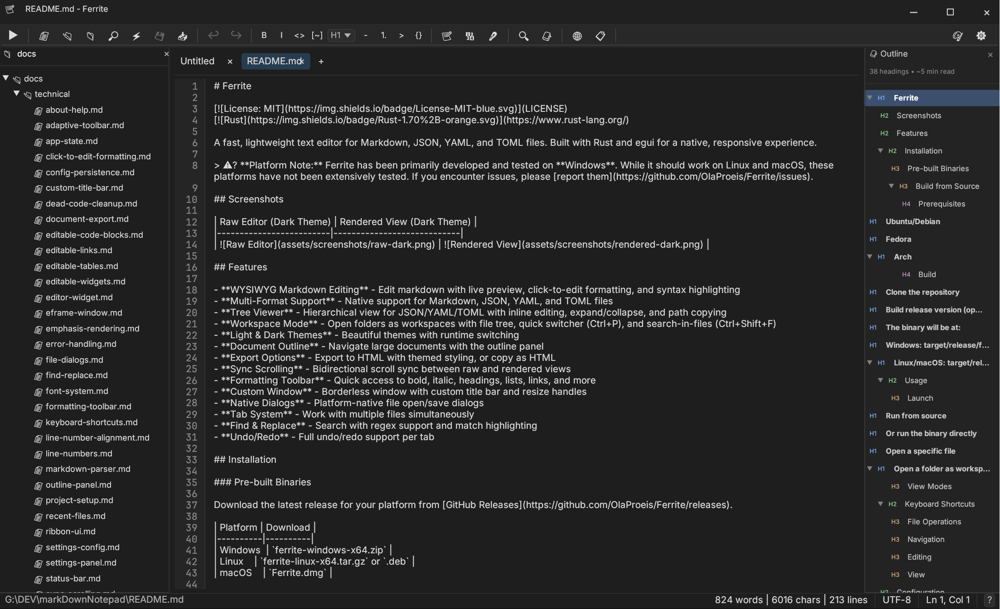

# Ferrite

**简体中文** | [English](README.md)

<div align="center">

[](https://getferrite.dev)
[](https://github.com/OlaProeis/Ferrite/releases)
[](LICENSE)
[](https://github.com/OlaProeis/Ferrite/stargazers)
[](https://github.com/OlaProeis/Ferrite/issues)
[](https://hosted.weblate.org/engage/ferrite/)

**[getferrite.dev](https://getferrite.dev)** — 官网：下载、功能介绍与文档

</div>

面向 Markdown、JSON、YAML、TOML 的轻量级文本编辑器，使用 Rust 与 egui 构建，原生、流畅。

> ⚠️ **平台说明：** Ferrite 主要在 **Windows** 与 **Linux** 上开发与测试。macOS 支持为实验性。若遇问题请 [提交 Issue](https://github.com/OlaProeis/Ferrite/issues)。

<details>
<summary><strong>🛡️ 代码签名与杀毒软件</strong></summary>

自 v0.2.6.1 起，**所有 Windows 版本均使用** [SignPath Foundation](https://signpath.org) 证书进行数字签名。这意味着：

- **Windows SmartScreen** 可识别发布者，不再出现“未知发布者”提示
- **杀毒软件误报** 因可信签名而明显减少
- **完整性校验** — 可验证程序未被篡改

### 以往误报说明
未签名的旧版本仍可能被部分杀毒软件报毒，原因包括：
- **Live Pipeline 功能**：在 Windows 上使用 `cmd.exe /C` 执行 shell 命令，可能被机器学习检测误判
- **Rust 编译特征**：Rust 二进制具有独特特征，可能触发启发式检测

我们已通过代码签名、构建配置调整（关闭符号剥离、优化等级）以及向 Microsoft 安全情报中心反馈来改善此问题。

### 若仍被拦截
若 Windows Defender 隔离了 Ferrite：
1. **升级**：从 [GitHub Releases](https://github.com/OlaProeis/Ferrite/releases) 下载最新已签名版本
2. **验证签名**：右键 `ferrite.exe` → 属性 → 数字签名 → 应显示 “SignPath Foundation”
3. **VirusTotal**：将文件上传至 [VirusTotal](https://www.virustotal.com)，已签名版本应显示为安全

Ferrite **不会**访问密码、浏览器数据，也不进行网络连接。应用完全离线，仅访问您明确打开的文件。

</details>

## 🤖 AI 辅助开发

本项目代码 100% 由 AI 生成。所有 Rust 代码、文档与配置均由 Claude (Anthropic) 通过 [Cursor](https://cursor.com) 与 MCP 工具编写。

<details>
<summary><strong>关于 AI 工作流</strong></summary>

### 我的角色
- **产品方向** — 决定做什么、为什么做
- **测试** — 运行应用、发现 bug、验证功能
- **审阅** — 阅读生成代码、理解实现
- **协调** — 有效管理 AI 工作流

### 工作流
1. **想法细化** — 与多个 AI（Claude、Perplexity、Gemini Pro）讨论概念
2. **PRD 编写** — 使用 [Task Master](https://github.com/task-master-ai/task-master) 生成需求
3. **任务执行** — Claude Opus 负责实现（偏好较大任务而非大量子任务）
4. **会话交接** — 结构化提示在会话间保持上下文
5. **人工审阅** — 每次交接经审阅，必要时调整方向

📖 **详情：** [AI 开发工作流](docs/ai-workflow/ai-development-workflow.md)

### 开放流程
用于构建 Ferrite 的实际提示与文档均公开：

| 文档 | 用途 |
|----------|----------|
| [`current-handover-prompt.md`](docs/current-handover-prompt.md) | 当前会话上下文 |
| [`ai-workflow/`](docs/ai-workflow/) | 工作流文档、PRD、历史交接 |
| [`handover/`](docs/handover/) | 可复用交接模板 |

此举旨在透明，方便他人学习并改进这一方式。

</details>

## 截图


| 纯文本编辑 | 分栏视图 | 禅模式 |
|------------|------------|----------|
|  |  |  |

> ✨ **v0.3.1（最新变更，尚未打标签）：** 内嵌 **YouTube 视频**。**多窗口**。Mermaid 第二批（git graph 重写、图表弹窗、适应预览宽度、`autonumber`、`linkStyle interpolate basis`）。**CSV 单元格编辑**。**GitHub HTML 子集**与 HTML 实体。**GFM 表格对齐**。**预览锁定**。**搜索优先的设置**（`config.json` 防损坏）。**拼写检查**。渲染视图与终端可分别选字体。**Tab / Shift+Tab 缩进**。**表情符号**回退。**剪贴板图片粘贴**。**从磁盘重新加载**。编辑与保存时**保留 CRLF**。渲染预览中的**方向键**与**查找定位**。**macOS Finder“打开方式”**。按输入段撤销。四轮 Linux QA。收尾修复：切换或保存编码不再丢字或写成 `&#NNNN;`（[#197](https://github.com/OlaProeis/Ferrite/issues/197)、[#198](https://github.com/OlaProeis/Ferrite/issues/198)）；CSV 单元格提交保留文件中部的 Raw 修改（[#196](https://github.com/OlaProeis/Ferrite/issues/196)）；渲染列表会显示嵌套块并保留折行。LSP 推迟到 v0.3.2+。Linux 上 YouTube 内嵌的 Error 153 推迟到 v0.3.2。详见 [CHANGELOG.md](CHANGELOG.md) § Unreleased 和 [ROADMAP.md](ROADMAP.md)。

> 📦 **v0.3.0：** **eframe / egui 0.34.2** 平台升级。**PDF + 主题 HTML 导出**。**可执行代码块**（`▶ 运行`）。**渲染编辑会话**。**分栏滚动同步**。**用户强调色**。**Mermaid** 插入工具栏与流程图优化。**Phosphor 图标**。**会话恢复**。**快速笔记工作流**。详见 [CHANGELOG.md](CHANGELOG.md) § 0.3.0。

> 📦 **v0.2.6 亮点：** 全新自定义编辑器引擎与虚拟滚动（80MB 文件约 80MB 内存）、多光标编辑、代码折叠、IME/CJK 输入改进。

## 功能

### 核心编辑
- **所见即所得 Markdown 编辑** — 实时预览；渲染模式下**一键在标题、段落、列表、表格单元格之间切换**；点击编辑格式；语法高亮。*(v0.3.1)* 方向键在渲染块之间移动（预览锁定时改为滚动）；状态栏行列跟随光标；列表项会显示其中的段落、代码、引用和表格，折行条目会保留续行
- **可执行代码块** — 在渲染/分栏预览中运行 shell 或 Python 围栏代码块（`▶ 运行`）；内联 ANSI 输出、超时与停止（设置中可选；首次运行需确认）
- **YouTube 视频** *(v0.3.1)* — 单独一行写 `{{video URL}}` 即可在主窗口的渲染预览中播放；其他窗口与不受信任的站点显示缩略图并在浏览器中打开
- **多格式支持** — 原生支持 Markdown、JSON、CSV、YAML、TOML
- **多编码支持** — 自动检测并保持编码（UTF-8、Latin-1、Shift-JIS、Windows-1252、GBK 等）。*(v0.3.1)* 编辑和保存保留 Windows CRLF；脏文件切换编码前会询问；无法表示的字符不会被写成 `&#NNNN;`
- **从磁盘重新加载** *(v0.3.1)* — `Ctrl+Shift+R` 用磁盘上的文件替换当前标签（有未保存修改时先询问）
- **GitHub HTML 子集** *(v0.3.1)* — `<div align>`、`<details>/<summary>`、`<br>`、`<kbd>`、`<sup>`、`<sub>` 与带尺寸的 `` 会在预览中渲染；HTML 实体显示为字符
- **GFM 表格对齐** *(v0.3.1)* — 渲染表格按列左/中/右对齐
- **树形查看器** — JSON/YAML/TOML 层级视图，内联编辑、展开/折叠、路径复制
- **查找与替换** — 支持正则、匹配高亮。*(v0.3.1)* 下一条/上一条会把渲染视图和分栏预览滚到匹配处
- **跳转到行 (Ctrl+G)** — 快速跳转到指定行
- **撤销/重做** — 每标签页独立撤销/重做；*(v0.3.1)* 连续输入合并为一步撤销

### 视图模式
- **分栏视图** — 左侧源码、右侧渲染预览，可调分隔；两侧均可编辑；可选**实时滚动同步**（小地图 **Sync** / **2-way** 控制）
- **禅模式** — 无干扰写作，居中文本列
- **多窗口** *(v0.3.1)* — `Ctrl+Shift+N` 打开带独立标签栏的第二个窗口；窗口布局会在下次启动时恢复
- **预览锁定** *(v0.3.1)* — 预览窗格上的锁（`Insert`）使渲染侧只读，源码侧仍可编辑

### 编辑器功能
- **语法高亮** — 100+ 语言全文件高亮（Rust、Python、JavaScript、Go、TypeScript、PowerShell 等）
- **代码折叠** — 边栏指示器 (▶/▼) 折叠/展开标题、代码块、列表
- **语义小地图** — 可点击标题、内容类型与密度条；可切换为 VS Code 风格像素视图
- **多光标编辑** — Ctrl+点击添加多光标；同时输入、删除、导航
- **括号匹配** — 高亮匹配 `()[]{}<>` 与 `**` `__`
- **括号与引号自动闭合** — 输入 `(`, `[`, `{`, `"`, `'` 自动补全；支持选区包裹
- **复制行 (Ctrl+Shift+D)** — 复制当前行或选区
- **上/下移行 (Alt+↑/↓)** — 无需剪切粘贴即可调整行顺序
- **链接智能粘贴** — 选中文字后粘贴 URL 自动生成 `[文字](url)` 链接
- **拖放图片** — 将图片拖入编辑器，自动保存到 `./assets/` 并插入 Markdown 链接
- **从剪贴板粘贴图片** *(v0.3.1)* — 剪贴板是图片时 `Ctrl+V` 会保存 PNG 到 `./assets/` 并插入链接；未保存且无工作区的笔记会先弹出另存为
- **Tab / Shift+Tab 缩进** *(v0.3.1)* — 在源码编辑器中缩进或减少所选行的缩进
- **拼写检查** *(v0.3.1，默认关闭)* — 源码编辑器中的英语 Hunspell：虚线下划线、右键建议、个人词典
- **目录** — 用 `<!-- TOC -->` 块从标题生成/更新目录 (Ctrl+Shift+U)
- **代码片段** — `;date` → 当前日期、`;time` → 当前时间及自定义片段
- **自动保存** — 可配置，带临时文件保护
- **行号** — 可选行号边栏
- **可配置行宽** — 80/100/120 或自定义，便于阅读
- **自定义字体** — 编辑器与界面字体；适合 CJK 地区字形偏好
- **快捷键自定义** — 在设置中重绑快捷键

### Mermaid 图表
预览中原生渲染 11 种图表：
- 流程图、时序图、饼图、状态图、思维导图
- 类图、ER 图、Git 图、甘特图、时间线、用户旅程
- **插入模板** — 格式工具栏 → **插入 → Mermaid…** 按图表类型插入示例代码
- **内联校验** — 预览显示解析错误；原始编辑器中对损坏的 `mermaid` 块显示波浪线
- **流程图优化** — 改进边路由、更多形状、`style` / classDef；状态图支持 fork/join 与 history 节点

- **图表弹窗与适应宽度** *(v0.3.1)* — 点击图表打开可缩放查看器；过宽的图会缩进预览，每个图可在适应宽度与原始尺寸之间切换
- **Git graph 与 autonumber** *(v0.3.1)* — 支持标签、分支类型、cherry-pick、LR/TB；时序图支持 `autonumber`；流程图支持 `linkStyle … interpolate basis` 与 `%% @pos`

> **v0.3.1 Mermaid 更新：** 在 v0.3.0 的插入工具栏、F1 语法帮助、内联校验和边路由之上，增加弹窗查看器、适应预览宽度、git graph 重写、`autonumber` 与平滑连线。密集图和子图布局仍可能与 mermaid.js 不同。计划见 [ROADMAP.md](ROADMAP.md)。

### CSV/TSV 查看器
- **原生表格视图** — 固定列宽、格式化显示
- **列交替着色** — 提高可读性
- **分隔符检测** — 自动识别逗号、制表符、分号、竖线
- **表头检测** — 智能识别并高亮表头行
- **单元格编辑** *(v0.3.1)* — 双击单元格即可在表格视图中编辑（小文件）；Tab / Shift+Tab 与方向键在单元格间移动；大文件仍在 Raw 视图编辑

### 工作区功能
- **工作区模式** — 打开文件夹、文件树、快速切换 (Ctrl+P)、文件内搜索 (Ctrl+Shift+F)
- **工作区文件索引** — Ctrl+P 与文件内搜索在后台扫描**整个工作区**（不限于树中已展开的文件夹）
- **快速笔记工作流** — 无路径草稿标签：默认退出时不弹保存对话框；关闭标签仍会提示；未保存内容通过会话恢复保留（设置 → 文件）
- **Git 集成** — 修改/新增/未跟踪/忽略状态指示，保存、焦点、文件变更时自动刷新
- **会话保持** — 重启后恢复打开的标签、光标位置、滚动位置；加固崩溃恢复（身份校验与磁盘冲突横幅）

### 终端工作区
- **集成终端** — 多实例，可选 shell（PowerShell、CMD、WSL、bash）
- **平铺与分屏** — 水平/垂直分割，组成 2D 网格
- **智能最大化** — 临时放大任意窗格 (Ctrl+Shift+M)
- **布局持久化** — 将终端布局保存/加载为 JSON
- **主题与透明** — 自定义配色（如 Dracula）、背景透明度
- **拖拽标签** — 重排终端，带视觉反馈
- **AI 就绪** — 终端等待输入时显示“呼吸”指示，便于 AI 代理

### 其他功能
- **浅色与深色主题** — 运行时切换；**自定义 Ferrite 强调色**（设置 / 欢迎页）用于标题、选区、标签与界面
- **文档大纲与统计** — 大纲面板导航；字数、阅读时间、标题/链接/图片数量
- **导出与打印** — 导出 **PDF** 或**主题 HTML**（选项对话框、Mermaid 内联 SVG）；**打印预览**在应用内 PDF 查看器中打开临时文件；复制为 HTML
- **格式工具栏** — 粗体、斜体、标题、列表、链接、Mermaid 插入等
- **Phosphor 图标** — 功能区、工具栏、面板与预览控件统一图标字体
- **Live Pipeline** — 通过 shell 命令处理 JSON/YAML（面向开发者）
- **自定义窗口** — 无边框、自定义标题栏与缩放
- **最近文件与文件夹** — 状态栏点击文件名访问
- **CJK 段落首行缩进** — 中文（2 字）、日文（1 字）等选项

## 安装

### 预编译包

从 [GitHub Releases](https://github.com/OlaProeis/Ferrite/releases) 下载对应平台最新版本。

| 平台 | 下载 | 说明 |
|----------|----------|-------|
| **Windows** | `ferrite-windows-x64.msi` | 推荐 — 完整安装包，含开始菜单 |
| Windows | `ferrite-portable-windows-x64.zip` | 便携 — 解压即用，可放 U 盘 |
| **Linux (Debian/Ubuntu)** | `ferrite-editor_amd64.deb` | Debian、Ubuntu、Mint、Pop!_OS |
| **Linux (Fedora/RHEL)** | `ferrite-editor.x86_64.rpm` | Fedora、RHEL、CentOS、Rocky |
| Linux | `ferrite-linux-x64.tar.gz` | 通用 — 适用于多数发行版 |
| **macOS (Apple Silicon)** | `ferrite-macos-arm64.dmg` | 推荐 — 拖入"应用程序"即可 (M1/M2/M3) |
| macOS (Apple Silicon) | `ferrite-macos-arm64.tar.gz` | 替代 — 包含 Ferrite.app |
| **macOS (Intel)** | `ferrite-macos-x64.dmg` | 推荐 — 拖入"应用程序"即可 |
| macOS (Intel) | `ferrite-macos-x64.tar.gz` | 替代 — 包含 Ferrite.app |

<details>
<summary><strong>Windows 安装</strong></summary>

#### MSI 安装包（推荐）

下载 `ferrite-windows-x64.msi` 并运行：
- 安装到 `C:\Program Files\Ferrite`
- 开始菜单快捷方式与图标
- 可通过 Windows 设置卸载
- 配置保存在 `%APPDATA%\ferrite\`

#### 便携版 (ZIP)

下载 `ferrite-portable-windows-x64.zip` 解压到任意位置。压缩包包含：
- `ferrite.exe` — 主程序
- `portable/` — 配置与数据目录
- `README.txt` — 简要说明

**真正便携：** 所有配置、会话与数据均在可执行文件旁的 `portable` 目录，不写入 `%APPDATA%` 或注册表，适合 U 盘或免安装试用。

</details>

<details>
<summary><strong>Linux 安装</strong></summary>

#### Debian/Ubuntu/Mint (.deb)

```bash
# 下载 .deb 后安装：
sudo apt install ./ferrite-editor_amd64.deb

# 或使用 dpkg：
sudo dpkg -i ferrite-editor_amd64.deb
```

#### Fedora/RHEL/CentOS (.rpm)

```bash
# 下载 .rpm 后安装：
sudo dnf install ./ferrite-editor.x86_64.rpm

# 或使用 rpm：
sudo rpm -i ferrite-editor.x86_64.rpm
```

.deb 与 .rpm 将：
- 安装到 `/usr/bin/ferrite`
- 添加桌面项（出现在应用菜单）
- 注册 `.md`、`.json`、`.yaml`、`.toml` 关联
- 安装系统图标

#### Arch Linux (AUR)

[](https://aur.archlinux.org/packages/ferrite/)
[](https://aur.archlinux.org/packages/ferrite-bin/)

[AUR](https://wiki.archlinux.org/index.php/Arch_User_Repository) 提供：
- [Ferrite](https://aur.archlinux.org/packages/ferrite/)（发布包）
- [Ferrite-bin](https://aur.archlinux.org/packages/ferrite-bin/)（二进制包）

```console
# 发布包
yay -Sy ferrite

# 二进制包
yay -Sy ferrite-bin
```

#### Nix / NixOS（官方 flake）

```bash
# 直接从 GitHub 运行（无需安装）
nix run github:OlaProeis/Ferrite

# 进入包含 ferrite 的 shell 环境
nix shell github:OlaProeis/Ferrite
```

从本地克隆：

```bash
# 构建
nix build .#ferrite
./result/bin/ferrite

# 进入开发 shell（Rust 工具链 + 系统依赖）
nix develop
```

#### 其他 Linux (tar.gz)

```bash
tar -xzf ferrite-linux-x64.tar.gz
./ferrite
```

</details>

<details>
<summary><strong>macOS 安装</strong></summary>

#### DMG 安装包（推荐）

根据 Mac 类型下载 `.dmg`：
- **Apple Silicon**（M1/M2/M3/M4）：`ferrite-macos-arm64.dmg`
- **Intel**：`ferrite-macos-x64.dmg`

打开 DMG，将 `Ferrite.app` 拖入**应用程序**文件夹。从启动台或 Spotlight 启动。

#### 从 tar.gz（替代）

```bash
# Apple Silicon
tar -xzf ferrite-macos-arm64.tar.gz
cp -R Ferrite.app /Applications/

# Intel
tar -xzf ferrite-macos-x64.tar.gz
cp -R Ferrite.app /Applications/
```

> **Gatekeeper 提示：** 若 macOS 显示"无法打开，因为它来自身份不明的开发者"，右键点击 `Ferrite.app` 并选择**打开**，然后在对话框中点击**打开**。此操作仅需一次。

</details>

<details>
<summary><strong>从源码构建</strong></summary>

#### 前置要求

- **Rust 1.70+** — 从 [rustup.rs](https://rustup.rs/) 安装
- **平台依赖：**

**Nix 用户：** 可跳过手动安装依赖，在仓库根目录使用 `nix develop`（见 `flake.nix`）。

**Windows：**
- Visual Studio Build Tools 2019+，含 C++ 工作负载

**Linux：**

```bash
# Ubuntu/Debian
sudo apt install build-essential pkg-config libgtk-3-dev libxcb-shape0-dev libxcb-xfixes0-dev

# Fedora
sudo dnf install gcc pkg-config gtk3-devel libxcb-devel

# Arch
sudo pacman -S base-devel pkg-config gtk3 libxcb
```

**macOS：**

```bash
xcode-select --install
```

#### 构建

```bash
# 克隆仓库
git clone https://github.com/OlaProeis/Ferrite.git
cd Ferrite

# 构建 release（优化）
cargo build --release

# 生成文件位置：
# Windows: target/release/ferrite.exe
# Linux/macOS: target/release/ferrite

# macOS：创建 .app 包（可选）
cargo install cargo-bundle
cargo bundle --release
# 包位置: target/release/bundle/osx/Ferrite.app
```

> **macOS「打开方式」限制：** 应用包包含文件类型关联，Ferrite 会出现在 Finder 的「打开方式」中，但通过该方式打开文件（或拖放到应用图标）目前因 [eframe/winit 限制](https://github.com/rust-windowing/winit/issues/1751) 尚未支持。**变通：** 用终端 `open -a Ferrite path/to/file.md` 或在应用内通过 文件 → 打开。

> **开发版：** 从 `main` 分支构建可获得未发布功能，但未经完整测试，可能含 bug。稳定版请从 [GitHub Releases](https://github.com/OlaProeis/Ferrite/releases) 下载。

</details>

## 使用

```bash
# 打开文件
ferrite path/to/file.md

# 以工作区打开文件夹
ferrite path/to/folder/
```

<details>
<summary><strong>更多命令行选项</strong></summary>

```bash
# 从源码运行
cargo run --release

# 或直接运行二进制
./target/release/ferrite

# 多文件多标签打开
./target/release/ferrite file1.md file2.md

# 显示版本
./target/release/ferrite --version

# 显示帮助
./target/release/ferrite --help
```

完整 CLI 说明见 [docs/cli.md](docs/cli.md)。

</details>

### 视图模式

Markdown 支持三种视图：

- **纯文本** — 带语法高亮的纯文本编辑
- **渲染** — 所见即所得编辑
- **分栏** — 左侧源码、右侧实时预览

通过工具栏或快捷键切换。

## 快捷键

| 快捷键 | 操作 |
|----------|----------|
| `Ctrl+N` | 新建 |
| `Ctrl+O` | 打开 |
| `Ctrl+S` | 保存 |
| `Ctrl+W` | 关闭标签 |
| `Ctrl+P` | 快速切换文件 |
| `Ctrl+F` | 查找 |
| `Ctrl+G` | 跳转到行 |
| `Ctrl+,` | 打开设置 |

<details>
<summary><strong>完整快捷键</strong></summary>

### 文件

| 快捷键 | 操作 |
|----------|----------|
| `Ctrl+N` | 新建 |
| `Ctrl+O` | 打开 |
| `Ctrl+S` | 保存 |
| `Ctrl+Shift+S` | 另存为 |
| `Ctrl+W` | 关闭标签 |

### 导航

| 快捷键 | 操作 |
|----------|----------|
| `Ctrl+Tab` | 下一标签 |
| `Ctrl+Shift+Tab` | 上一标签 |
| `Ctrl+P` | 快速切换文件（工作区） |
| `Ctrl+Shift+F` | 在文件中搜索（工作区） |

### 编辑

| 快捷键 | 操作 |
|----------|----------|
| `Ctrl+Z` | 撤销 |
| `Ctrl+Y` / `Ctrl+Shift+Z` | 重做 |
| `Ctrl+F` | 查找 |
| `Ctrl+H` | 查找替换 |
| `Ctrl+G` | 跳转到行 |
| `Ctrl+Shift+D` | 复制行 |
| `Alt+↑` | 上移行 |
| `Alt+↓` | 下移行 |
| `Ctrl+B` | 粗体 |
| `Ctrl+I` | 斜体 |
| `Ctrl+K` | 插入链接 |

### 视图

| 快捷键 | 操作 |
|----------|----------|
| `F11` | 全屏 |
| `Ctrl+,` | 打开设置 |
| `Ctrl+Shift+[` | 全部折叠 |
| `Ctrl+Shift+]` | 全部展开 |

### 终端工作区

终端快捷键在终端面板获得焦点时生效。

| 快捷键 | 操作 |
|----------|----------|
| `Ctrl+Tab` / `Ctrl+Shift+Tab` | 切换终端标签 |
| `Ctrl+1-9` | 切换到指定终端标签 |
| `Ctrl+方向键` | 在分屏间移动焦点 |
| `Ctrl+Shift+M` | 最大化/还原当前窗格 |
| `Ctrl+L` | 清屏 |
| `Ctrl+Shift+C` | 复制选区/屏幕 |
| `Ctrl+Shift+V` | 粘贴到终端 |
| `Ctrl+W` / `Ctrl+F4` | 关闭当前窗格 |
| `双击标签` | 重命名终端 |

</details>

## 配置

通过 `Ctrl+,` 或齿轮图标打开设置，可配置外观、编辑行为与文件处理。

<details>
<summary><strong>配置说明</strong></summary>

配置存放位置：

- **Windows：** `%APPDATA%\ferrite\`
- **Windows 便携：** `ferrite.exe` 旁的 `portable\` 目录
- **Linux：** `~/.config/ferrite/`
- **macOS：** `~/Library/Application Support/ferrite/`

**便携模式（Windows）：** 若可执行文件旁存在 `portable` 目录，Ferrite 将全部使用该目录而非 `%APPDATA%`，实现完全自包含，适合 U 盘。

工作区设置保存在工作区目录下的 `.ferrite/`。

### 设置项

- **外观：** 主题、字体、字号、默认视图
- **编辑器：** 自动换行、行号、小地图、括号匹配、代码折叠、语法高亮、自动闭合括号、行宽
- **文件：** 自动保存、最近文件历史

</details>

## 路线图

计划功能与已知问题见 [ROADMAP.md](ROADMAP.md)。

## 参与贡献

欢迎贡献。请参阅 [CONTRIBUTING.md](CONTRIBUTING.md)。

### 帮助翻译

Ferrite 正在社区帮助下翻译为多种语言。

[](https://hosted.weblate.org/engage/ferrite/)

**[在 Weblate 上帮助翻译 Ferrite](https://hosted.weblate.org/engage/ferrite/)** — 无需编程！

<details>
<summary><strong>贡献者快速入门</strong></summary>

```bash
# Fork 并克隆
git clone https://github.com/YOUR_USERNAME/Ferrite.git
cd Ferrite

# 创建功能分支
git checkout -b feature/your-feature

# 修改后检查
cargo fmt
cargo clippy
cargo test
cargo build

# 可选（Nix 用户）：验证 flake 输出
nix flake check

# 提交并推送
git commit -m "feat: your feature description"
git push origin feature/your-feature
```

</details>

## 技术栈

Rust 1.70+，egui/eframe 图形界面，comrak Markdown 解析，ropey 绳索文本，syntect 语法高亮。

<details>
<summary><strong>完整技术栈</strong></summary>

| 组件 | 技术 |
|-----------|------------|
| 语言 | Rust 1.70+ |
| GUI | egui 0.28 + eframe 0.28 |
| 文本缓冲 | ropey 1.6 |
| Markdown 解析 | comrak 0.22 |
| 语法高亮 | syntect 5.1 + two-face 0.5 |
| Git | git2 0.19 |
| 终端 PTY | portable-pty 0.8 |
| 终端 ANSI | vte 0.13 |
| 编码检测 | encoding_rs 0.8 + chardetng 0.1 |
| 国际化 | rust-i18n 3 + sys-locale 0.3 |
| CLI | clap 4 |
| 文件对话框 | rfd 0.14 |
| 剪贴板 | arboard 3 |
| 文件监视 | notify 6 |
| 模糊匹配 | fuzzy-matcher 0.3 |
| HTTP | ureq 2（更新检查） |
| 哈希 | blake3 1.5（Mermaid 缓存） |
| 日期时间 | chrono 0.4 |
| CSV 解析 | csv 1.3 |
| 调色 | palette 0.7 |
| 字体枚举 | font-kit 0.14 |
| 分配器 (Windows) | mimalloc 0.1 |
| 分配器 (Unix) | tikv-jemallocator 0.6 |

</details>

## 许可证

本项目采用 MIT 许可证，详见 [LICENSE](LICENSE)。

## 致谢

### 库
- [egui](https://github.com/emilk/egui) 与 eframe — 即时模式 GUI 与原生窗口集成
- [ropey](https://github.com/cessen/ropey) — 大文件编辑用 rope 文本缓冲
- [comrak](https://github.com/kivikakk/comrak) — CommonMark + GFM Markdown 解析
- [syntect](https://github.com/trishume/syntect) 与 [two-face](https://github.com/CosmicHorrorDev/two-face) — 语法高亮与扩展语言定义
- [harfrust](https://github.com/harfbuzz/harfrust) — 复杂文本的 OpenType 字形排版
- [git2](https://github.com/rust-lang/git2-rs) — libgit2 Rust 绑定
- [portable-pty](https://github.com/wez/wezterm) 与 [vte](https://github.com/alacritty/vte) — 集成终端（PTY 与 ANSI 解析）
- [image](https://github.com/image-rs/image) — 光栅图像解码（Markdown 预览与图片查看）
- [hayro](https://github.com/LaurenzV/hayro) — 纯 Rust PDF 光栅化（PDF 查看标签页）
- [rust-i18n](https://github.com/longbridge/rust-i18n) — 国际化（i18n）
- [Inter](https://rsms.me/inter/) 与 [JetBrains Mono](https://www.jetbrains.com/lp/mono/) 字体

### 开发工具
- [Claude](https://anthropic.com) (Anthropic) — 编写代码的 AI 助手
- [Cursor](https://cursor.com) — AI 代码编辑器
- [Task Master](https://github.com/eyaltoledano/claude-task-master) — 开发任务管理

### 贡献者
- [@starSumi](https://github.com/starSumi) — Windows 单实例窗口前置（[PR #148](https://github.com/OlaProeis/Ferrite/pull/148)）；标签栏右键菜单与路径提示（[PR #150](https://github.com/OlaProeis/Ferrite/pull/150)）；大纲树视觉优化（[PR #151](https://github.com/OlaProeis/Ferrite/pull/151)）；测试构建修复（[PR #152](https://github.com/OlaProeis/Ferrite/pull/152)）；Linux WebView CI 依赖（[PR #156](https://github.com/OlaProeis/Ferrite/pull/156)）；在文件管理器中打开本地 Markdown 链接（[PR #157](https://github.com/OlaProeis/Ferrite/pull/157)）；Mermaid 弹出查看器、frontmatter 属性卡片、Markdown 速查表、返回上一标签按钮（[PR #158](https://github.com/OlaProeis/Ferrite/pull/158)）；Mermaid 子图标题宽度（[PR #159](https://github.com/OlaProeis/Ferrite/pull/159)）；Windows git 状态修复（[PR #160](https://github.com/OlaProeis/Ferrite/pull/160)、[PR #161](https://github.com/OlaProeis/Ferrite/pull/161)）
- [@moabtools](https://github.com/moabtools) — 渲染视图中 Ctrl+Home / Ctrl+End 跳转到文档首尾（[PR #137](https://github.com/OlaProeis/Ferrite/pull/137)）
- [@liuxiaopai-ai](https://github.com/liuxiaopai-ai) — Nix/NixOS flake 支持，可复现构建与开发 shell（[PR #92](https://github.com/OlaProeis/Ferrite/pull/92)）
- [@blizzard007dev](https://github.com/blizzard007dev) — 首次启动欢迎页（[PR #80](https://github.com/OlaProeis/Ferrite/pull/80)）
- [@wolverin0](https://github.com/wolverin0) — 集成终端工作区与 Productivity Hub（[PR #74](https://github.com/OlaProeis/Ferrite/pull/74)）
- [@abcd-ca](https://github.com/abcd-ca) — 删除行、移动行、macOS 文件关联（[PR #29](https://github.com/OlaProeis/Ferrite/pull/29)、[#30](https://github.com/OlaProeis/Ferrite/pull/30)）
- [@SteelCrab](https://github.com/SteelCrab) — CJK 字符渲染（[PR #8](https://github.com/OlaProeis/Ferrite/pull/8)）

## 赞助方

<table>
  <tr>
    <td>
      <a href="https://signpath.io/?utm_source=foundation&utm_medium=github&utm_campaign=ferrite" target="_blank"></a>
    </td>
    <td>
      Windows 免费代码签名由 <a href="https://signpath.io/?utm_source=foundation&utm_medium=github&utm_campaign=ferrite">SignPath.io</a> 提供，证书来自 <a href="https://signpath.org/?utm_source=foundation&utm_medium=github&utm_campaign=ferrite">SignPath Foundation</a>
    </td>
  </tr>
  <tr>
    <td>
      <a href="https://weblate.org/" target="_blank"></a>
    </td>
    <td>
      托管翻译由 <a href="https://weblate.org/">Weblate</a> 通过 <a href="https://hosted.weblate.org/">Hosted Weblate</a> 提供（自由软件项目免费方案）
    </td>
  </tr>
</table>

---

<sub>若 Ferrite 对您有帮助，欢迎 [赞助开发](https://github.com/sponsors/OlaProeis)。</sub>
