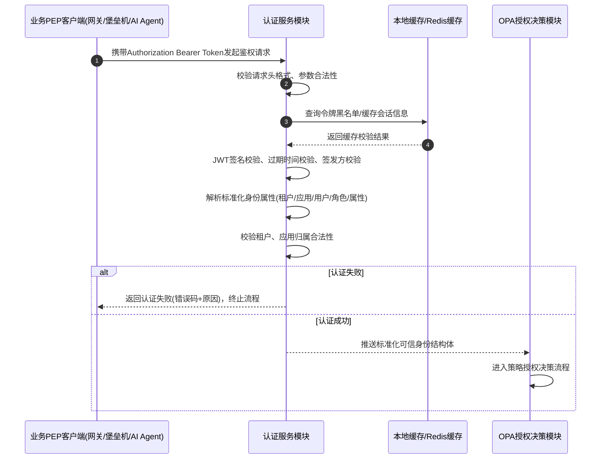
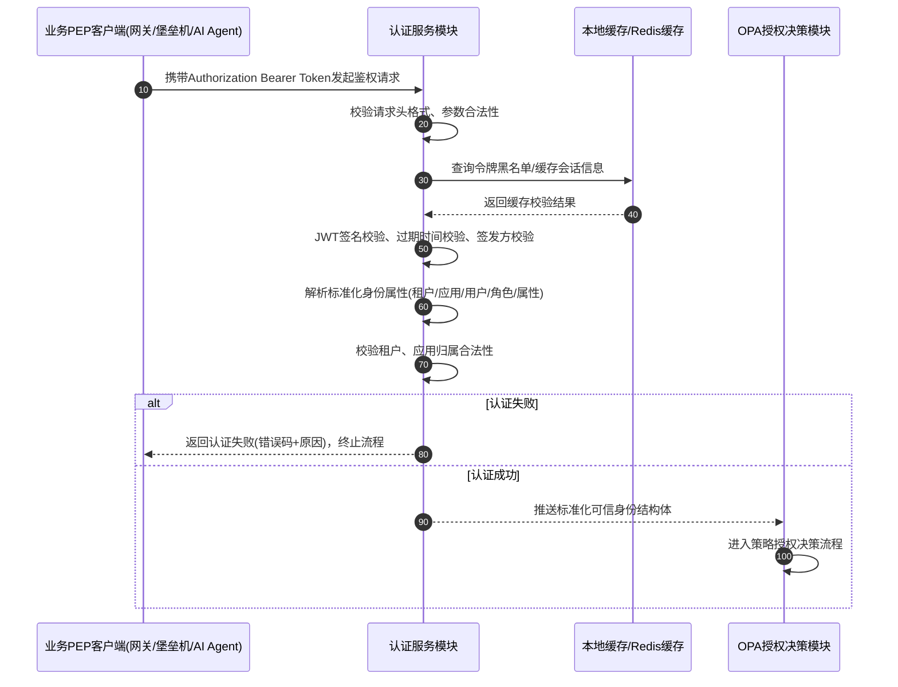

# MMD-10 variants (QA test input, derived from test_mermaid_issue_165.md FC-165b)

## V0 baseline (autonumber)

## VA: autonumber off after 4th message (expect badges 1-4 only)

## VB: autonumber 10 10 (expect 10,20,30...)

