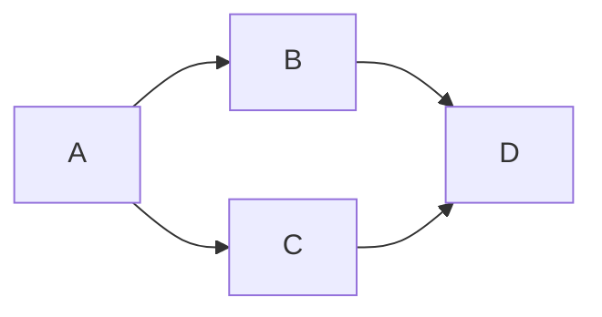

# Ferrite v0.3.1 — Round 4 prep

Prepared: 2026-11-10 00:01 CET (Europe/Oslo, UTC+1)
Gate doc: `/workspace/ferrite-qa/rerun4/rerun-v0.3.1-round4.md` (copied from attachment)

## 1. Directories

```
/workspace/ferrite-qa/rerun4/{shots,logs,files,work}  created
gate doc copied → rerun-v0.3.1-round4.md (126 lines, 15307 bytes)
```

## 2. Git

- Branch: `0.3.1-experimental`
- Working tree was clean; fast-forwarded `d1d4d15` → `1ad150b` (2 commits).
- **HEAD:** `1ad150bc140ef1665f7b5e1fa9edc1257690fb6c` (`1ad150b`)
- Fix commit present: `e56243c fix(qa): v0.3.1 GrokBot round 4 direct fixes (ISS-76/77/78/79, SES-3)`

```
1ad150b docs(qa): GrokBot round 3 report, round 4 re-run gate for e56243c (ISS-76..79, SES-3)
e56243c fix(qa): v0.3.1 GrokBot round 4 direct fixes (ISS-76/77/78/79, SES-3)
d1d4d15 docs(qa): reference round-3 fix commit 8c9c2d5 in PRD, report and re-run gate
08aabd0 docs(qa): GrokBot QA round 3 triage, PRD and re-run gate (ISS-64..75)
8c9c2d5 fix(qa): v0.3.1 GrokBot round 3 direct fixes (ISS-64/65/67/68/72/74/75)
```

### Task commits since d1d4d15

- **task 1 (YouTube / ISS-69):** NOT present → Section E YouTube rows remain **BLOCKED-by-build**
- **task 4 (div align / T3-44):** NOT present → T3-44 remains **BLOCKED-by-build** / known PARTIAL 0.3.2

Only `e56243c` + `1ad150b` landed since round 3 HEAD.

## 3. Build markers (all ≥ 1 — OK)

| Marker | File | Count |
|--------|------|------:|
| `Rendered arrow nav` | `src/markdown/editor.rs` | 2 |
| `take_locked_preview_arrow_presses` | `src/markdown/editor.rs` | 3 |
| `basis_curve_segments` | `src/markdown/mermaid/flowchart/utils.rs` | 6 |
| `close_document_window_now` | `src/app/windows.rs` | 2 |

## 4. `cargo build --release --locked`

- **OK.** Finished in ~2m 12s. Log: `logs/build.log`
- Binary: `/workspace/ferrite-qa/ferrite/target/release/ferrite` (ferrite 0.3.1, 46.6 MB, mtime 2026-11-10 00:00 CET)
- 38 warnings (pre-existing style/dead-code); no errors.

## 5. `cargo test --locked`

- Log: `logs/cargo-test.log`
- `running 2251 tests`
- **test result: ok. 2249 passed; 0 failed; 2 ignored; 0 measured; 0 filtered out; finished in 2.58s**
- Sum of all `test result:` lines: **2249 / 0 / 2** (matches gate §D expected Linux totals; round 3 was 2235 + 14 new = 2249).
- `app::rendered_commit_point_tests::switch_tab_commits_previous_tab_content` did **not** fail — no solo re-run needed.

## 6. Config backup

- Copied `~/.config/ferrite` → `/workspace/ferrite-qa/rerun4/config-backup-start/ferrite/` (`cp -a`, byte-identical; session.json sha256 `01bf6769…`).
- Contents: `config.json`, `config.json.bak`, `session.json`, `recovery/`, `spellcheck/`.

### Session `preview_locked` finding

Session has **per-tab** `preview_locked` (43 tabs in window[0]). Gate note confirmed: lock is stored per tab / path.

- **locked=true (2 tabs):**
  - `/workspace/ferrite-qa/rerun3/work/test_find_arrow_nav.md` (split) — fixture copy from round 3
  - `/workspace/ferrite-qa/rerun3/work/paste-img7/paste.md` (split)
- Canonical `test_md/` fixture paths are all **unlocked** right now:
  - `test_md/test_find_arrow_nav.md` → unlocked, raw
  - `test_md/test_copy_and_split_undo.md` → unlocked, split
  - `test_md/test_github_html.md` → unlocked, rendered
  - `test_md/test_mermaid_v031.md` → unlocked, rendered

**Harness implication:** use a **fresh work/ copy** of each fixture per row (as the gate already says). Do not reopen the round-3 `rerun3/work/test_find_arrow_nav.md` path without unlocking — it will come back locked. State padlock position every row; crop it into one screenshot.

## 7. Tools & launcher

| Tool | Status |
|------|--------|
| `scrot` | `/usr/bin/scrot` 1.12.1 |
| `xclip` | `/usr/bin/xclip` 0.13 |
| `xdotool` | `/usr/bin/xdotool` 3.20160805.1 |
| `maim` | `/usr/bin/maim` v5.8.0 |
| `run-ferrite.sh` | `/workspace/ferrite-qa/run-ferrite.sh` (present; not under rerun3/) |

Env still up: Xvfb `:2` 1920×1200, xfwm4, `DISPLAY=:2`.

## 8. Fixtures

All four exist under `/workspace/ferrite-qa/ferrite/test_md/`:

| File | Bytes | Notes |
|------|------:|-------|
| `test_find_arrow_nav.md` | 2565 | 79 lines |
| `test_mermaid_v031.md` | 2434 | §3 updated for S-curve expect |
| `test_copy_and_split_undo.md` | 2022 | |
| `test_github_html.md` | 5272 | |

### `test_find_arrow_nav.md` stop-line check — OK

Doc stop lines `8,10,12,16,18,21,23,24,25,27,29,32,34,44,46,49,54` all present with expected content (headings / paragraphs / list items / blockquote / Section 4).

Rust fence at **36–42** (` ```rust ` … ` ``` `). Step-over path: line **34** (`The word ferrite appears here again.`) → line **44** (`## Section 4`).

### `test_mermaid_v031.md` §3

```
## 3. linkStyle interpolate basis (smooth curves)



Expect: each of the four edges is a smooth S-curve (LR horizontal leave/enter).
Note: straight chain `A --> B --> C --> D` cannot curve — use fan-out/fan-in.
```

## Ready for GUI

Build markers OK, release binary OK, cargo test 2249/0/2 OK, tools OK, fixtures OK.
Suggested run order from gate: **A → C → B → D**. Section E stays BLOCKED-by-build (no task 1 / task 4 commits).
