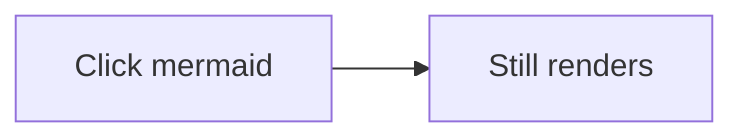

# Rendered Edit Session — Manual Test Document

Use this file in **Rendered** or **Split** view to verify one-click click-to-edit across every session-backed block type (Tasks 94–105).

**How to test each section:**

1. Switch to Rendered (R) or Split (S) view.
2. Click into the block; type a few characters.
3. Single-click a **different** block — expect immediate focus (no second click).
4. Switch to Raw view — confirm markdown source matches what you typed.
5. Check the box in [`docs/archive/release-qa/v0.3.0-manual-test-suite.md`](../docs/archive/release-qa/v0.3.0-manual-test-suite.md) as you go.

---

## RS-1 — Heading switch (Alpha / Beta)

# Alpha

Edit this heading, then single-click **Beta** below. Alpha must save; Beta must focus on first click.

# Beta

Now edit Beta and single-click **Gamma**.

# Gamma

---

## Headings — all levels

Click each heading, add a word, then jump to the next heading with one click.

# Heading 1 — click me

## Heading 2 — click me

### Heading 3 — click me

#### Heading 4 — click me

##### Heading 5 — click me

###### Heading 6 — click me

Alternative title
=================

Setext H1 — click to edit the title text.

Setext subtitle
---------------

Setext H2 — click to edit.

---

## RS-2 — Cursor stability

Click between the letters in this heading and type continuously for several seconds without clicking again.

# Cur s or stab i l i ty test heading

Same test on this plain paragraph: click mid-sentence and keep typing. The caret should not flash or vanish.

---

## Plain paragraphs

This is a plain paragraph with no inline formatting. Click anywhere in the sentence and edit.

This is a second plain paragraph. Edit here, then single-click the third paragraph in one action.

This is the third plain paragraph. Switch back to the first with one click.

Paragraph with a soft line break in source
that continues on the next line — should edit as one block.

---

## Simple bullet lists

- First plain bullet — click and edit
- Second plain bullet — switch here from first with one click
- Third plain bullet
  - Nested plain bullet level 2
  - Another nested item — test nested → parent switch
- Back at level 1

---

## Simple numbered lists

1. First numbered item
2. Second numbered item — edit then jump to third
3. Third numbered item
   1. Nested numbered a
   2. Nested numbered b

---

## Formatted paragraphs (Task 100)

Click the **styled** text (not Raw markers). After editing, click outside or another block — must return to styled view.

This paragraph has **bold text** in the middle.

This paragraph has *italic emphasis* throughout the span.

This paragraph has ~~strikethrough text~~ for removal.

This paragraph mixes **bold**, *italic*, ~~strike~~, and `inline code` in one line.

This has ***bold and italic*** together.

This has **bold with `code` inside** the emphasis.

This has a [markdown link](https://example.com) — click link vs click text carefully.

This has a `code span` adjacent to **bold** with no extra gap issues.

Long formatted line stress test: Lorem ipsum **dolor sit amet** consectetur adipiscing elit sed do eiusmod tempor incididunt ut labore et dolore magna aliqua *Ut enim ad minim veniam* quis nostrud exercitation ullamco laboris nisi ut aliquip ex ea commodo consequat **Duis aute irure** dolor in reprehenderit.

---

## Formatted bullet lists (RS-3, RS-4)

- Plain bullet before formatted ones
- Item with **bold word** only
- Item with *italic phrase* in the middle
- Item with ~~strikethrough~~ applied
- Item with **bold** and *italic* and `code` combined
- ***Bold italic*** stress item

Edit the **first formatted item** above, then single-click the **second formatted item** — RS-4.

---

## Formatted numbered lists

1. Step with **important** keyword
2. Step with *note* in italics
3. Step with ~~deprecated~~ marker
4. Final **bold** step — switch from 1 → 4 in one click after editing

---

## Task lists

- [ ] Unchecked task — plain text
- [x] Checked task — plain text
- [ ] Task with **bold action** item
- [ ] Task with *italic reminder*
- [x] Completed ~~old~~ **new** priority

Toggle checkboxes without entering edit mode. Click task text to edit.

---

## RS-5 — Table then heading

Edit a cell in the table below, then single-click the heading **After the table** — table must commit; heading must focus.

| Name | Role | Notes |
|------|------|-------|
| Alice | Admin | Primary contact |
| Bob | Editor | Secondary |
| | Empty cell | Click empty cells too |

### After the table

Click this heading after editing the table above.

---

## Tables — navigation & empty cells (TBLE-1…3)

### Basic 3×3

| A | B | C |
|---|---|---|
| 1 | 2 | 3 |
| 4 | 5 | 6 |
| 7 | 8 | 9 |

Tab from `9` wraps; Shift+Tab reverses. Text must land only in the active cell.

### Empty cells

| Col 1 | Col 2 | Col 3 |
|-------|-------|-------|
| filled | | |
| | empty | |
| | | |

Click each empty cell; type; Tab across empties without committing mid-grid.

### Inline formatting in cells

| Style | Example |
|-------|---------|
| Bold | **strong** |
| Italic | *slanted* |
| Strike | ~~removed~~ |
| Code | `fn main()` |
| Mixed | **bold** *italic* `code` |
| Link | [docs](https://docs.rs) |

Open `test_md/task_50_table_inline_formatting.md` for the full formatting matrix.

### Wide table (toolbar Add column / Add row)

| C1 | C2 | C3 | C4 | C5 |
|----|----|----|----|-----|
| a | b | c | d | e |

Use table toolbar: **Add column**, click new empties, type. **Add row**, repeat. Blur table — verify Raw source.

---

## Blockquotes

> Plain blockquote paragraph — click to edit if session-backed, or verify render.

> Blockquote with **bold** and *italic* inline formatting.

> Nested style test with `code` and [link](https://example.com).

---

## Code blocks (not session — separate widget path)

Verify click-to-edit still works; behaviour is **not** the RenderedEditSession coordinator.

```rust
fn hello() {
    println!("Edit this Rust block");
}
```

```python
def greet(name):
    return f"Hello, {name}!"
```

```bash
echo "Edit this shell block"
```

---

## Mixed block sequence (cross-type switching)

Edit each block in order using **single-click** transitions only:

# Step 1 — heading

Plain paragraph for step 2.

- Bullet for step 3 with **bold**

| Step | 4 table |
|------|---------|
| cell | edit |

## Step 5 — another heading

Formatted finish: ***done*** — click outside to dismiss.

---

## Split view (RS-6)

1. Open this file in **Split** view.
2. Edit the line below in the **raw** left pane:

`SPLIT_TEST_MARKER: change this text in raw pane`

3. Confirm the rendered right pane updates.
4. Click a heading in the rendered pane — must load updated source.

---

## Undo smoke (Task 103)

1. Click `# Alpha` (top), change text, click `# Beta` (commit).
2. Ctrl+Z once — Alpha text reverts.
3. Edit a formatted bullet with **bold**, click away, Ctrl+Z — one step reverts.

---

## Non-session blocks (sanity)

These should render and remain interactive but use separate edit paths:



> [!NOTE]
> GitHub callout — collapse toggle if supported.

---

## Wikilinks & images (click vs edit)

See `test_md/test_wikilinks.md` for dedicated wikilink tests.

Local image (if `assets/` present):  — should show broken indicator, not panic.

---

## Performance smoke

Scroll this filler section quickly in a large session. Session switching should stay snappy.

<details>
<summary>Filler paragraphs (expand in Raw only — skip if not supported)</summary>

Filler paragraph 1. Filler paragraph 2. Filler paragraph 3.

</details>

---

## Checklist quick reference

| ID | What to verify in this file |
|----|----------------------------|
| RS-1 | Alpha → Beta → Gamma heading switch |
| RS-2 | Cursor stability heading + paragraph |
| RS-3 | Formatted bullet → click outside → styled |
| RS-4 | Formatted bullet → formatted bullet |
| RS-5 | Table cell → "After the table" heading |
| RS-6 | Split raw edit + rendered re-click |
| RS-7 | (trace log) epoch unchanged on rendered commit |
| TBLE-1 | Add column + empty cells |
| TBLE-2 | Add row + empty cells |
| TBLE-3 | Tab across empty cells |
