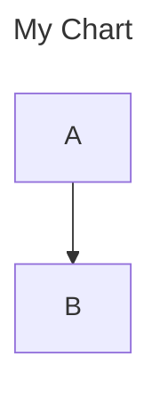

# Frontmatter Panel Testing Guide

Use this file to manually test the frontmatter editor panel (Task 32).

## How to Open the Panel

1. Open this file in Ferrite
2. Press **Ctrl+Shift+M** to toggle the frontmatter panel
3. The panel should appear on the **right side** of the editor

## Test Checklist

### 1. Panel Displays Correctly
- [ ] Panel shows on the right side when toggled
- [ ] All fields from the YAML above are visible
- [ ] Field labels follow file order, not alphabetical order: zebra, apple, title, date, author, draft, version, tags, categories, description
- [ ] `zebra` stays above `apple`
- [ ] Close button (X) works

### 2. Field Types Render Correctly
- [ ] `zebra` / `apple` / `title` / `date` / `author` / `description` → text input fields
- [ ] `draft` → checkbox (boolean)
- [ ] `version` → text/number input
- [ ] `tags` → pill/chip list with "rust", "egui", "markdown"
- [ ] `categories` → pill/chip list with "editor", "tools"

### 3. Panel → Raw Sync (Edit in panel, raw updates)
- [ ] Change the `title` field text → check that raw YAML updates
- [ ] Toggle the `draft` checkbox → raw YAML updates to `false`/`true`
- [ ] Add a new tag (type "test" in the tag input, press Enter or +) → raw YAML gets `- test`
- [ ] Remove a tag (click × on a tag pill) → raw YAML removes the entry

### 4. Raw → Panel Sync (Edit raw, panel updates)
- [ ] In the raw editor, change `title: Frontmatter Panel Test` to `title: Changed Title`
- [ ] The panel should update to show "Changed Title"
- [ ] Add a new YAML key manually in raw: `status: published` → panel shows new field

### 5. Add/Remove Fields via Panel
- [ ] Type "new_key" in the "new key..." input at the bottom and click Add
- [ ] A new empty string field should appear
- [ ] Click the trash icon (🗑) on a field to remove it
- [ ] Verify the raw YAML reflects the change

### 6. Empty State (No Frontmatter)
- [ ] Create a new file (Ctrl+N), press Ctrl+Shift+M
- [ ] Panel should show "No frontmatter detected" message
- [ ] Click "Add frontmatter" button
- [ ] Default frontmatter (title, date, tags) should be inserted at the top

### 7. Persistence
- [ ] Close the panel with the X button
- [ ] Setting should persist (panel stays closed on reopen)
- [ ] Panel width should persist after resize

---

## Edge Cases to Test

### Quoted strings
```yaml
description: "Contains: colons and #hashes"
```

### Empty list
```yaml
tags: []
```

### Null value
```yaml
subtitle:
```

### Nested objects (read-only display)
```yaml
metadata:
  created: 2026-01-01
  modified: 2026-03-04
```

---

## Notes

- The panel only appears for **Markdown** files (`.md`, `.markdown`)
- The panel is hidden in **Zen Mode** (F11)
- Panel width is resizable by dragging the left edge

## Mermaid YAML frontmatter

Open this file in Rendered or Split view. These diagrams use the same YAML parser as the properties card.

### Title still parses



**Expect:** the diagram draws `A --> B`, with the title **My Chart** above it.

### Broken frontmatter still renders

```mermaid
---
title: [broken
---
flowchart TD
  A --> B
```

**Expect:** no title. The block stays on the page and still shows the flowchart source (`A --> B`). A warning is fine. The block must not disappear.
